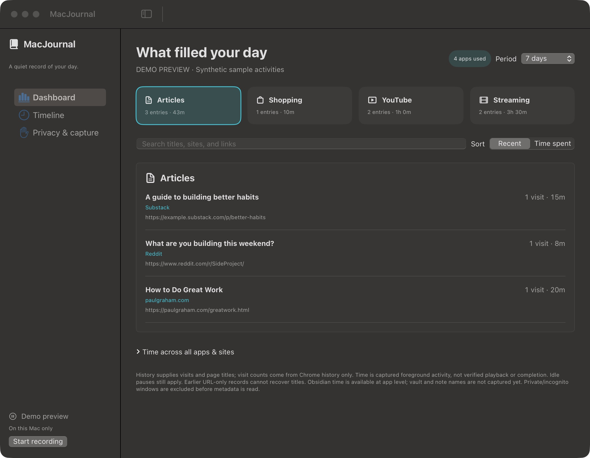
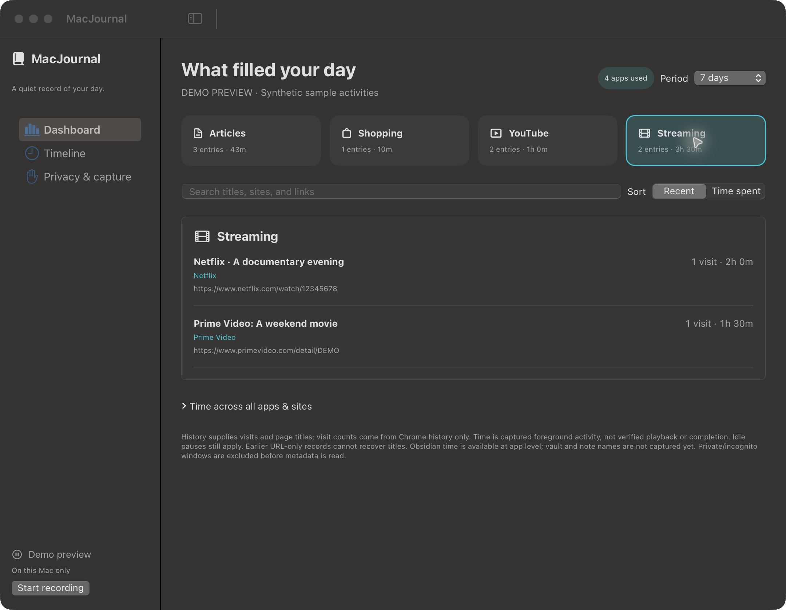

# MacJournal

A native macOS journal for the things you actually read and watch: article titles, Reddit threads, YouTube videos, shopping pages, and streaming titles. Built with SwiftUI through vibecoding, with local storage and a simple dashboard.

## Dashboard

Four categories keep activity together: **Articles · Shopping · YouTube · Streaming**. Search titles and sites, sort by recent activity or time spent, and switch between Today, 7 days, 30 days, and All time. A small badge shows apps used; an expandable summary shows time across apps and sites.

Screenshots below use a labelled **demo preview with synthetic activities**, never a user's browsing history.




## How capture works

- **Live capture** reads the foreground app and supported normal browser tab, sampling browser changes every three seconds and checkpointing every 15 seconds. Foreground time is approximate, not verified video playback or completion.
- **Chrome history** fills gaps with saved page titles and visit timestamps from one selected regular profile. It starts with today's visits, then syncs every 30 seconds while recording and browser capture are enabled. Where Chrome exposes visit origin, other-device visits are excluded.
- **Title readers** prefer visible headings for Reddit, blogs, Substack, and Amazon products; Netflix uses title-only player metadata. They fall back to the browser tab title when needed. Article bodies, comments, product descriptions, forms, keystrokes, and screenshots are not recorded.
- **Merging** groups history and live activity by sanitized URL. History contributes visit counts and zero duration; live capture contributes foreground time. Chrome stores the latest title for a URL, so earlier title changes cannot be reconstructed reliably.
- **Persistence** uses encrypted SQLite through GRDB + SQLCipher, with a random per-install key in macOS Keychain. Daily Markdown mirrors live in `~/Documents/MacJournal Notes`, which you can open in Obsidian. The mirrors are plain text; keep personal writing in separate files because generated notes are replaced on update.

## Privacy and limitations

Private/incognito windows are rejected before live metadata is read. The history reader accesses only a regular profile's History database, never incognito or session files. Safari, Firefox, Arc, and other unsupported browsers are skipped when their private-window state cannot be verified. Other Chromium adapters are implemented but only Chrome has been tested live.

App, URL, and title exclusions run before saving. URL credentials, queries, and fragments are stripped, except a validated YouTube video ID. Common credential patterns are redacted. Review the default exclusions and add your own sensitive apps and domains.

The history reader uses a restricted temporary local snapshot because Chrome may lock its database; the snapshot is removed after reading and Chrome's original files are unchanged. Stable visit identifiers avoid duplicate imports. Pausing, disabling browser capture, changing exclusions, switching profiles, and deleting activity advance the import boundary so pending visits do not return later.

The running app makes no network or model calls. It requires neither Accessibility nor Screen Recording permission. It is an unsandboxed development build; encryption at rest does not protect against software running as your user on an unlocked Mac. Markdown copies and external backups are independent of the encrypted database. Five-minute idle and sleep pauses apply to live capture. Obsidian activity is measured at app level, not individual vault or note level.

## Build and run

Apple Silicon, macOS 14+, and a Swift 6.1+ toolchain are required. Build dependencies are downloaded by SwiftPM.

```sh
swift run MacJournalChecks
CONFIGURATION=debug ./scripts/build-app.sh
open dist/MacJournal.app
```

The build script uses ad-hoc signing by default. Set `SIGNING_IDENTITY` to your own signing identity if available. Rebuilding or re-signing may cause macOS to request Keychain or browser permissions again. No prebuilt or notarized distribution is provided.

### Permissions

1. Allow the intended browser under **System Settings → Privacy & Security → Automation** when macOS asks.
2. For Chrome history on systems that protect browser data, enable **Privacy & Security → Files & Folders → MacJournal → Google Chrome**. Full Disk Access was not needed in the tested setup. Select the profile in the app's **Privacy & capture → Chrome history** section. The optional folder picker supports a read-only persistent bookmark for `~/Library/Application Support/Google/Chrome`.
3. Rich page and player headings require **Chrome → View → Developer → Allow JavaScript from Apple Events**. This permits apps with Chrome Automation permission to execute page scripts. MacJournal checks for a normal window before reading title metadata and revalidates the window, tab, and URL afterward.

Capture starts automatically unless manually paused. Pause or resume using **⌘⌥⇧P** or the app's visible button. History can be disabled separately. Delete the last hour, last day, or all captured activity from Privacy & capture; generated notes update too.

### Validation

`swift run MacJournalChecks` runs 88 checks covering encrypted storage and reopen, redaction and exclusions, private-window guard ordering, title grouping, deletion boundaries, Chrome history timestamp conversion, duplicate imports, device filtering, zero-duration history visits, and Markdown persistence. `swift test` is also available with a compatible full Xcode installation. Live Chrome checks covered Reddit, Substack, Amazon, YouTube, Netflix metadata, history import, and rejection of an incognito window. Playback completion and movie-versus-series classification are not inferred.

The public screenshot preview uses `local.MacJournal.demo` as a separate bundle identifier. It returns synthetic data before opening Keychain, a journal database, or any browser capture timers.

## Dependencies

[GRDB + SQLCipher](https://github.com/sqlcipher/GRDB.swift/tree/v7.10.0) provides encrypted storage. Browser capture uses [Chromium's AppleScript interface](https://www.chromium.org/developers/design-documents/applescript/); app capture uses [NSWorkspace](https://developer.apple.com/documentation/appkit/nsworkspace/frontmostapplication). The app icon was generated with OpenAI's image tool; see [asset notes](Assets/ICON.md).
